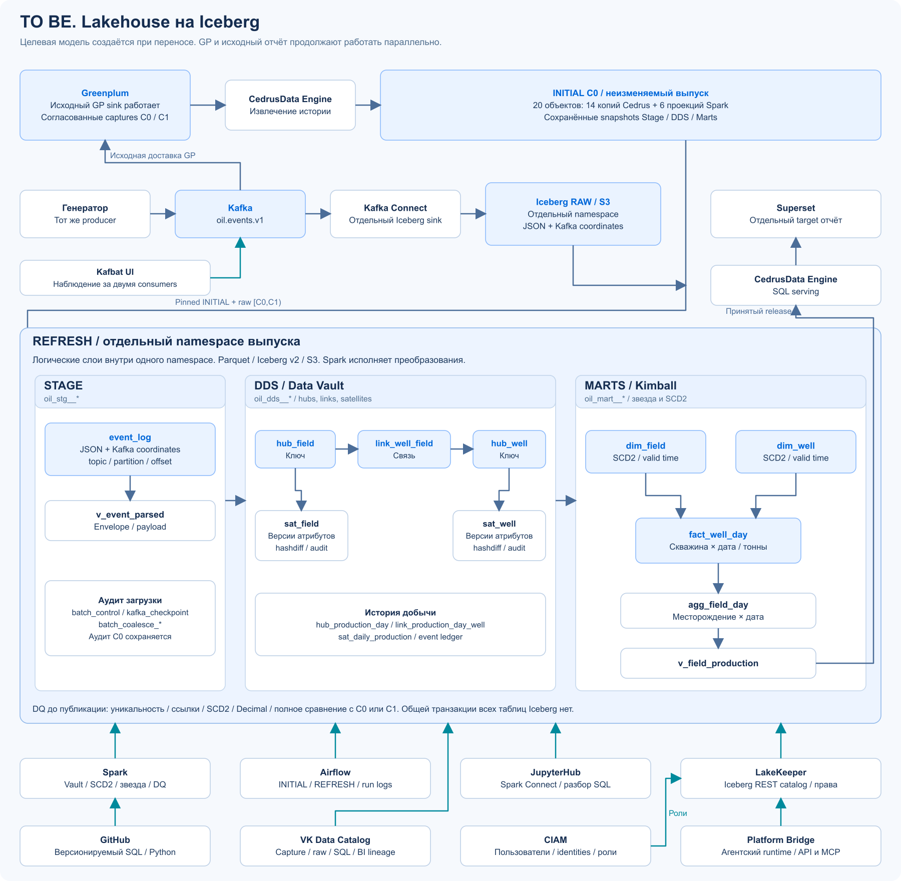

# TO BE / Lakehouse

Kafka raw хранится отдельно. INITIAL закрепляет исторический выпуск C0. REFRESH использует этот INITIAL и полное raw-окно C0/C1. Stage, DDS и Marts — логические группы таблиц oil_stg__*, oil_dds__*, oil_mart__* внутри namespace выпуска, а не три выдуманные физические схемы.

Синие стрелки показывают данные и связи моделей, бирюзовые — управление или метаданные. SVG — редактируемый оригинал, PNG — версия для просмотра. Схема описывает архитектуру; сама не создаёт объекты.

